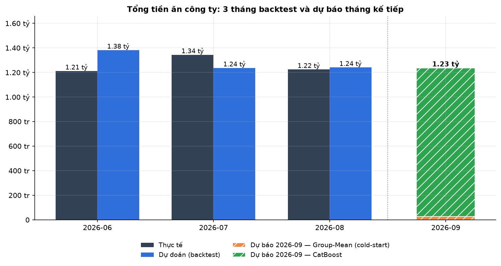
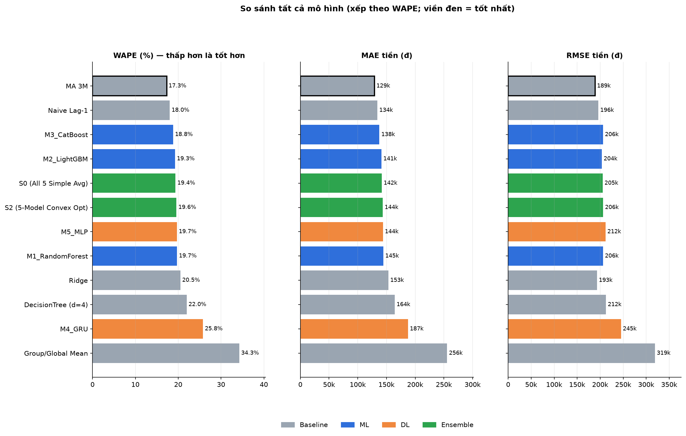
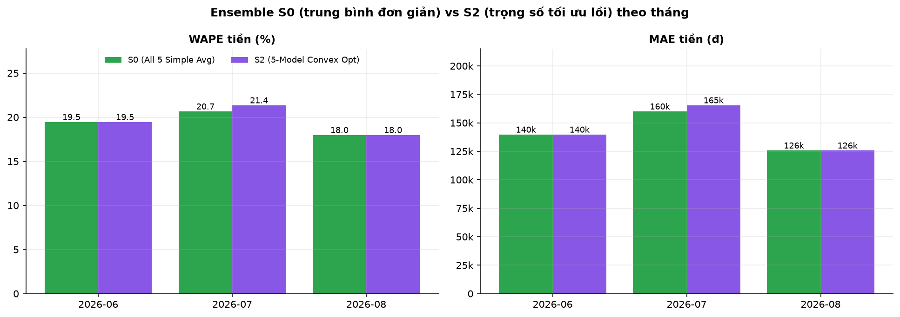
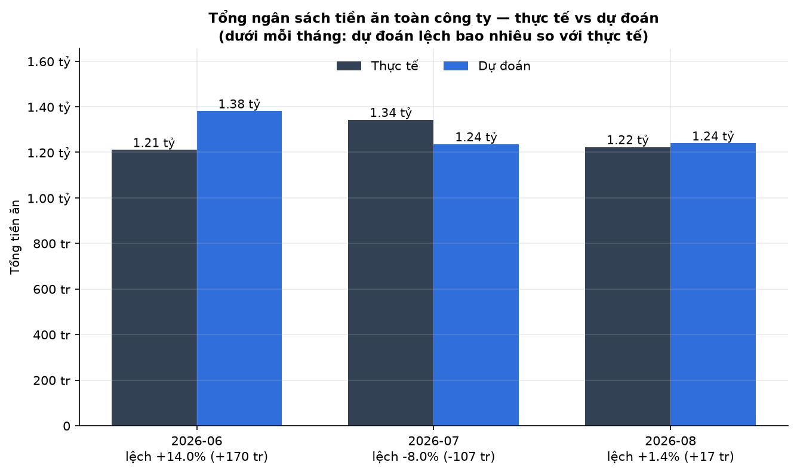
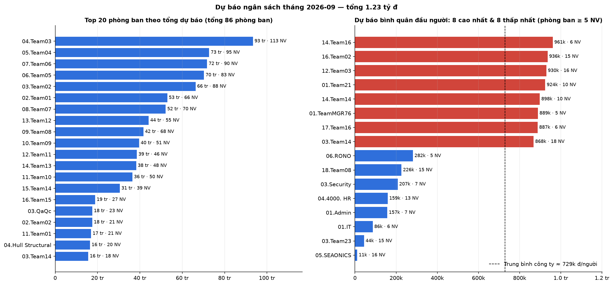

<div align="center">

# 🍱 Canteen Meal Budget Forecasting

**An end-to-end pipeline for meal forecasting, budget planning, and model evaluation.**



<br>


</div>

> [!IMPORTANT]
> Forecasts are for budgeting and meal preparation only. Do not use them to
> calculate bills or deduct money from employees. September 2026 actuals were not
> yet available for a like-for-like comparison in the latest run.

## At a glance

| Latest full run · October 19, 2026 | Result |
|---|---:|
| eCMS records cleaned | **409,885 → 353,668** |
| Employee-month history | **20,417 rows · 1,751 employees** |
| Historical coverage | **August 2025 – August 2026** |
| Features generated | **15,245 rows** |
| Backtest window | **June – August 2026** |
| September forecast after HR filtering | **1,694 employees · 1,236,612,000 VND** |

The full pipeline completed steps **1–9**. Step 10 waits for complete actual data
for the forecast month; the latest complete history month was August 2026.

## Results

Cost MAE and RMSE are measured in VND per employee-month. Lower is better. The
table below is from the latest run's metric files; the report figures provide a
visual overview.

| Model | Cost MAE | Cost RMSE | Cost WAPE |
|---|---:|---:|---:|
| **MA 3M baseline** | **129,230 VND** | **189,050 VND** | **17.32%** |
| Naive Lag-1 baseline | 134,170 VND | 196,096 VND | 18.02% |
| M3 CatBoost | 137,480 VND | 205,769 VND | 18.78% |
| M2 LightGBM | 141,234 VND | 203,375 VND | 19.26% |
| M1 Random Forest | 144,638 VND | 206,257 VND | 19.73% |
| M5 MLP | 142,950 VND | 210,165 VND | 19.56% |
| M4 GRU | 186,350 VND | 244,516 VND | 25.62% |
| Five-model ensemble | 141,514 VND | 205,116 VND | 19.33% |

The 3-month moving-average baseline had the lowest cost MAE and WAPE in this
three-month backtest. Production forecasts use CatBoost for employees with
sufficient history and a department-mean fallback for cold-start employees.

Company-wide budget WAPE was **13.73%** in June, **7.07%** in July, and **1.84%**
in August 2026.

### Forecast for September 2026

- **1,751** employees in the forecast cohort before HR filtering.
- **1,694** retained against `data/raw/hr.xlsx`; **57** excluded because they were
  absent from the current HR roster.
- Excluded employees represented **17,066,000 VND** of forecast cost.
- Retained forecast total: **1,236,612,000 VND**.
- Forecast meal counts: **27,478 N44** and **394 N70**.

This is a forecast, not September actual spending. Its actuals comparison is
pending complete September source data.

## Visual report

Selected charts from the pipeline figure index. Click a chart to open its full-size
image.

<p align="center">
  <a href="results/figures/01_model_leaderboard.png"></a>
  <a href="results/figures/03_ensemble_by_month.png"></a>
</p>
<p align="center">
  <a href="results/figures/05_company_budget.png"></a>
  <a href="results/figures/15_forecast_departments.png"></a>
</p>

## Run it

Run commands from the project root in PowerShell:

```powershell
python run_pipeline.py --check
python run_pipeline.py
```

Useful options:

```powershell
python run_pipeline.py --dry-run
python run_pipeline.py --from-step 5
python run_pipeline.py --only 1 2 10
python run_pipeline.py --no-hr-filter
```

Default inputs:

- `data/raw/MealHistory_UTF8.csv` — eCMS meal log.
- `data/raw/hr.xlsx` — active employee roster used by the forecast step.
- `data/raw/relax_day.xlsx` — holiday calendar.

The pipeline writes processed datasets to `data/processed/`, evaluation reports to
`results/metrics/`, forecasts to `results/forecast/`, and timestamped run logs to
`results/logs/`.

## Run the dashboard with Docker

The Docker image packages the Streamlit dashboard only. It does not include
employee data, forecasts, or other results: `data/` and `results/` are mounted
read-only at runtime. Put the required private files in those host folders before
starting the dashboard.

Create a `.env` file in the project root with the dashboard password:

```powershell
Set-Content -Path .env -Value 'DASHBOARD_PASSWORD=your-private-password'
docker compose up --build -d
```

Keep `.env` private; do not commit it. Compose passes this value into the
container.

Open <http://localhost:8501>. To stop the container, run
`docker compose down`. Do not commit the password or private input files.

GitHub Actions runs the unit tests and builds and health-checks the Docker image
on pushes and pull requests. The Docker job verifies the image locally; publishing
or deploying it requires a configured image registry and deployment target.

## Project map

| Path | Purpose |
|---|---|
| `src/` | Cleaning, aggregation, feature engineering, models, evaluation, and forecasting |
| `data/raw/` | Source meal logs, HR roster, and holiday calendar |
| `data/processed/` | Generated daily, monthly, and feature datasets |
| `results/metrics/` | Backtest, budget, segment, and outlier reports |
| `results/forecast/` | Employee- and department-level forecast CSVs |
| `results/figures/` | Charts for the model, budget, and forecast reports |
| `results/logs/` | Pipeline execution logs |
| `app.py` | Streamlit dashboard |
| `run_pipeline.py` | Pipeline entry point |

See [DEPLOYMENT.md](./DEPLOYMENT.md) for environment setup and operational
instructions.
